# The Report That Lies – Finding Errors in an Annual Sales Report

**Monthly Challenge – October** · Excel · Power Query · PivotTables · Copilot in Excel

I took over a 2025 annual sales report for a chain of bike shops from an analyst who had just left the company. The report was due to go to the management board in two days. I checked the data, the formulas and the conclusions, and found **22 errors**. After the corrections, the picture of the year is reversed: according to the original report the chain exceeded its target (112%), but in reality it **did not meet it (92.9%)**.

| Indicator | Original report | After corrections |
|---|---|---|
| Net revenue | PLN 15.14 m | **PLN 13.93 m** |
| Annual target | PLN 13.5 m (typed in manually) | **PLN 15.0 m** |
| Target achievement | 112% | **92.9%** |
| Margin | 82.1% (actually markup) | **45.2%** |
| Transactions | 14,998 (incl. cancelled and duplicates) | **14,110 completed** + 710 cancelled |
| December revenue | PLN 0.36 m (data only up to 10 Dec) | **PLN 1.17 m** |

**Files:** `Raport_ktory_klamie.xlsx` – Excel workbook with the original data, the cleaned data and the corrected report (in Polish; see the glossary in section 1).

## Contents

- [1. Goal of the exercise](#1-goal-of-the-exercise)
- [2. Overview of the file](#2-overview-of-the-file)
- [3. Work plan](#3-work-plan)
- [4. Checking the Data sheet in Power Query](#4-checking-the-data-sheet-in-power-query)
- [5. Checking the Report sheet](#5-checking-the-report-sheet)
- [6. Reviewing the conclusions](#6-reviewing-the-conclusions)
- [7. The report after the changes](#7-the-report-after-the-changes)
- [8. Dashboard](#8-dashboard)
- [9. Conclusions and recommendations for the board](#9-conclusions-and-recommendations-for-the-board)
- [10. Note to my manager](#10-note-to-my-manager)
- [11. Summary – list of errors](#11-summary--list-of-errors)

## 1. Goal of the exercise

The exercise simulates a situation that can happen in a data analyst's job. I take over a report from an analyst who has suddenly left the company. It is the 2025 annual sales report for a chain of bike shops called "Rowerownia", and it is due to go to the management board in two days. My manager only asks me to give it a quick check before it is sent.

According to the task description, the report contains hidden errors: in the data, in the formulas and in the business logic. The goal is to find as many of these errors as possible, describe how they affect the results, and practise checking someone else's work critically instead of taking it on trust.

### A note on language

The workbook and the screenshots are in Polish, because the dataset was provided in Polish. In this English version I use English names and give the original Polish name in brackets the first time it appears, e.g. "net value (Wartość_netto)". Excel functions are given with their English names (e.g. SUMIFS). Excel stores formulas in English internally, so in an English-language Excel the workbook shows exactly these names. The most important terms are listed below.

**Sheets**

| Polish name | English meaning |
|---|---|
| Raport | Report (the report for the management board) |
| Dane | Data (raw transaction data) |
| Dane_sprawdzenie | Data_check (transaction data after cleaning in Power Query) |
| Produkty / Produkty_nowe | Products / New products (models added from July 2025) |
| Cele | Targets (2025 sales targets per shop) |

**Columns in the data**

| Polish name | English meaning |
|---|---|
| ID_transakcji | Transaction ID |
| Data | Date (date and time of the transaction) |
| Sklep | Shop |
| Kategoria | Category |
| ID_produktu / Nazwa_produktu | Product ID / Product name |
| Ilość | Quantity |
| Cena_jednostkowa | Unit price |
| Rabat_% | Discount (%) |
| Wartość_netto | Net value (quantity × unit price after discount) |
| Status | Status: **Zrealizowana** = Completed, **Anulowana** = Cancelled |
| Koszt | Cost (cost of the whole transaction, not of one unit) |

**Key indicators in the report**

| Polish name | English name | How it should be calculated |
|---|---|---|
| Przychód netto 2025 | Net revenue 2025 | Sum of net value of completed transactions |
| Liczba wszystkich transakcji | Total number of transactions | Number of all transactions |
| Liczba transakcji zrealizowanych / anulowanych | Completed / cancelled transactions | Number of transactions with a given status, and their share of the total |
| Średnia wartość transakcji | Average transaction value | Net revenue ÷ number of completed transactions |
| Cel roczny sieci | Annual target for the chain | Sum of the shops' targets (Cele sheet) |
| Realizacja celu | Target achievement | Net revenue ÷ target |
| Koszt sprzedanych towarów | Cost of goods sold | Sum of cost of completed transactions |
| Marża % | Margin % | (Revenue − cost) ÷ revenue |
| Przychód Q4 | Q4 revenue | Net revenue from 1 October to 31 December |
| Udział Q4 w przychodzie rocznym | Q4 share of annual revenue | Q4 revenue ÷ net revenue |
| Udział w przychodzie | Share of revenue | Shop revenue ÷ total revenue |

**Category and month names:** Akcesoria = Accessories, Części = Parts, Odzież = Clothing, Rowery = Bikes, Rowery elektryczne = E-bikes, Serwis = Service. Months: Styczeń = January … Grudzień = December. Razem = Total. Amounts are in Polish zloty (PLN, "zł").

## 2. Overview of the file

First I look through the file. It consists of 5 sheets: **Raport** (Report), **Dane** (Data), **Produkty** (Products), **Produkty_nowe** (New products) and **Cele** (Targets).

### Report sheet

The Report sheet is the finished annual sales report for the board. It includes, among other things, net revenue, number of transactions, average transaction value, target achievement, cost of goods sold and margin. It also contains sales by shop, sales and margin by category, sales by month, and 5 conclusions.

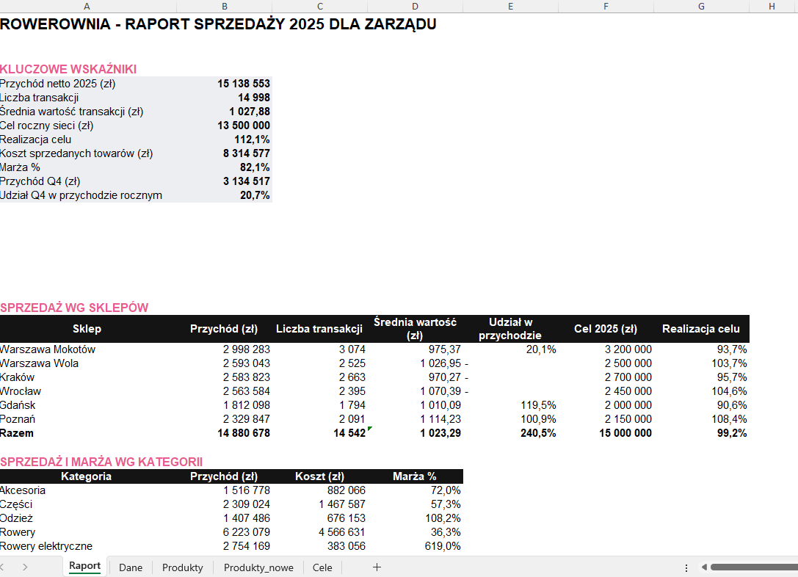

*Screen 1: Report sheet*

### Data sheet

Next is the Data sheet, with a large amount of data. I looked through it using filters. The data seem fine at first sight, with no obvious errors such as "Wroclaw" written without the Polish letter "ł" or names written as abbreviations. The dates also look fine. Still, I want to check for errors that could have slipped through, e.g. in formats, and whether the numbers really are numbers.

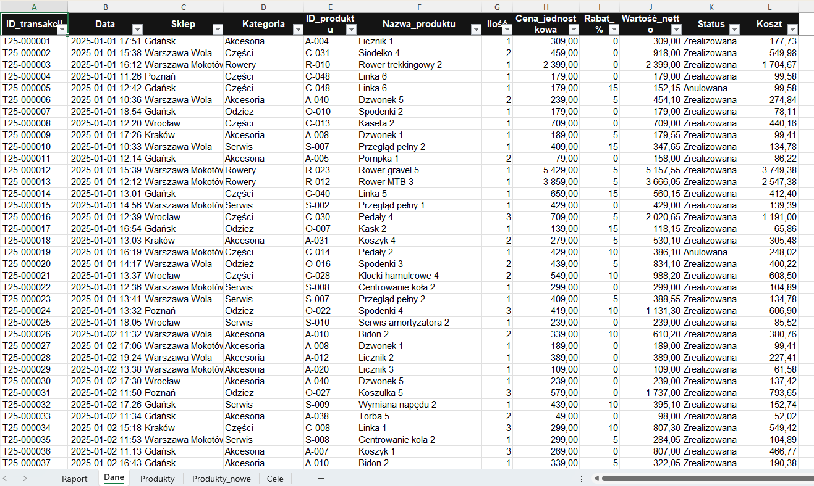

*Screen 2: Data sheet*

### Products sheet

The next sheet is Products. It contains the product ID, name, category, list price and unit cost. This also looks fine, although I think the formats should be checked here as well.

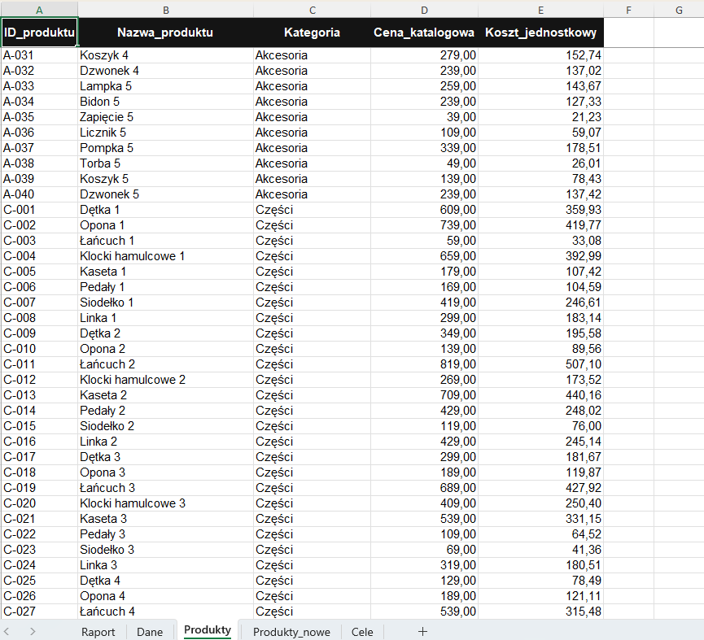

*Screen 3: Products sheet*

### New products sheet

The next sheet is Produkty_nowe (New products). These are new models added from July 2025 that have not yet been moved to the Products sheet. It may not be necessary, but I think it would be good to add them there.

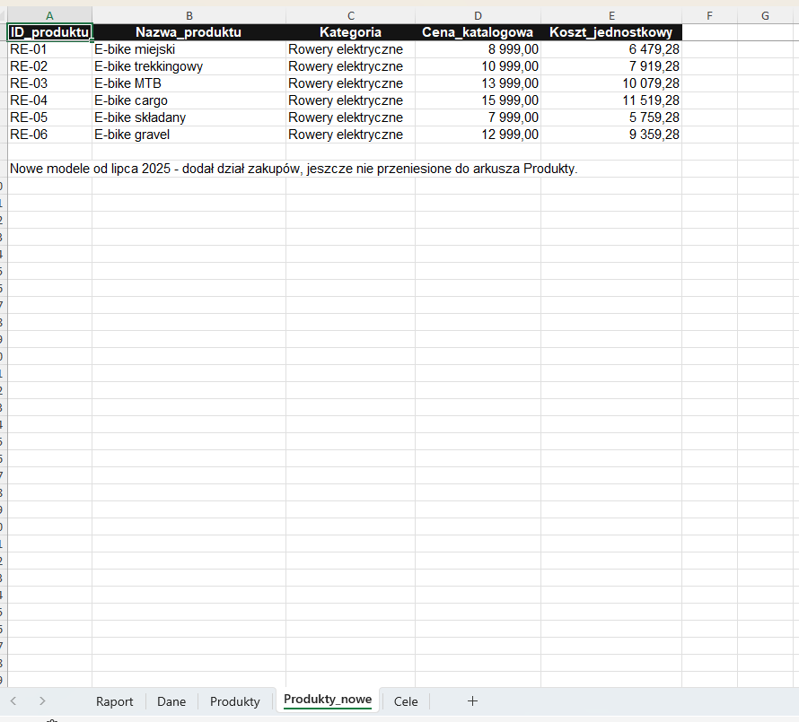

*Screen 4: New products sheet*

### Targets sheet

The last sheet is Cele (Targets). It contains the 2025 sales targets for the 6 shops.

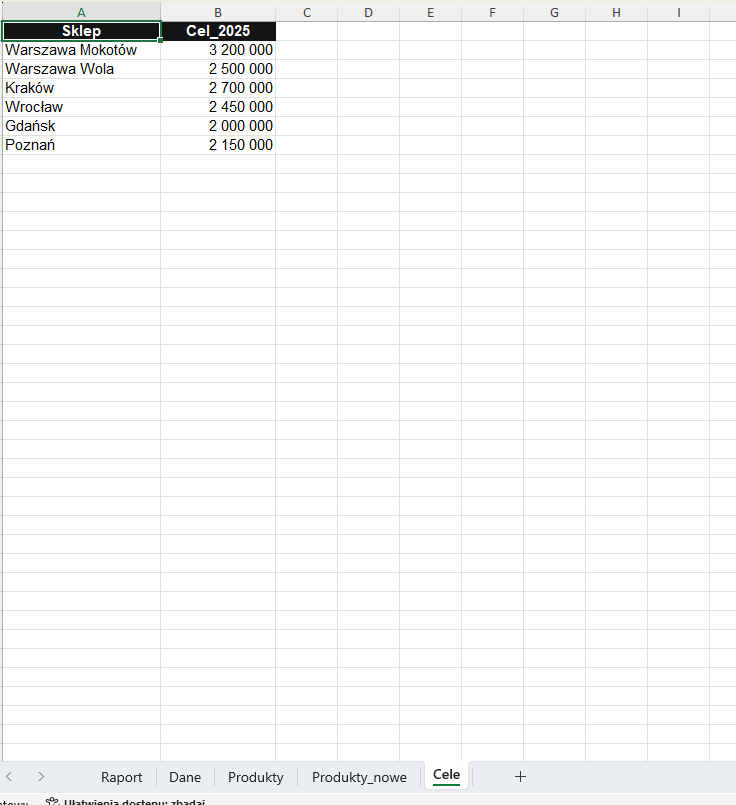

*Screen 5: Targets sheet*

## 3. Work plan

I start with the Data sheet to check whether it contains errors that could affect the report. From what I saw, the report was built mainly with Excel formulas. These will need checking too, but first of all I need to make sure the data itself is correct. If the source data is wrong, the whole report is wrong, so starting the corrections from the report itself would make no sense.

As mentioned, after a first look the data seems fine and I cannot see any errors. So this will be more about looking for subtle issues.

## 4. Checking the Data sheet in Power Query

### Preparation

I want to do the check in Power Query because I think it is well suited for it. I select the table, choose **Data → From Table/Range** (Dane → Z tabeli/zakresu) and open the Power Query editor.

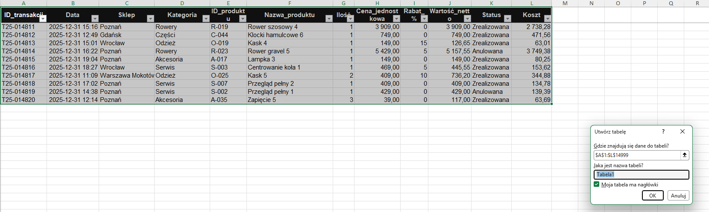

*Screen 6: Opening Power Query*

I name the checking query **Dane sprawdzenie** (Data check), as shown in screen 6.

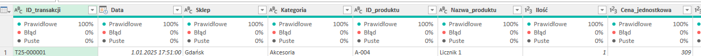

*Screen 7: Column quality*

Screen 7 shows part of the table. The first thing we see is column quality: the data is valid in every column, including the ones not visible in the screenshot. This confirms my impression that the data is fairly well prepared.

It is worth remembering that "valid" in column quality only means that the value matches the column's data type. A typo in a shop name or a wrong amount will also be "valid". That is why in the next steps I look at the column distribution and column profile.

On the **View** tab I turn on **Column distribution** and **Column profile**. I set column profiling to **based on entire data set**.

### ID_transakcji (Transaction ID)

The first thing that caught my eye was the transaction ID. There are **14,820 distinct** and **14,642 unique** values. These numbers should be the same, because every transaction should have its own number that does not repeat.

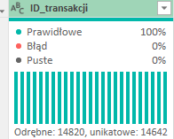

*Screen 8: Distribution of ID_transakcji*

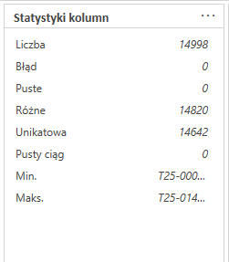

*Screen 9: Profile of ID_transakcji*

In the column profile I also checked the total number of rows: **14,998**. So we have three numbers:

- **Rows:** 14,998
- **Distinct:** 14,820
- **Unique:** 14,642

This means that **178 numbers** repeat (14,820 − 14,642), and there are also **178 extra rows** (14,998 − 14,820). So we can assume that each of these 178 IDs appears exactly twice.

I see two possible causes:

1. something was duplicated, i.e. there are identical rows,
2. the worse option: two different transactions (with a different date, product, etc.) received the same ID.

I select the whole table and choose **Remove Duplicates**. Selecting the whole table means that only rows which are identical in every column are removed.

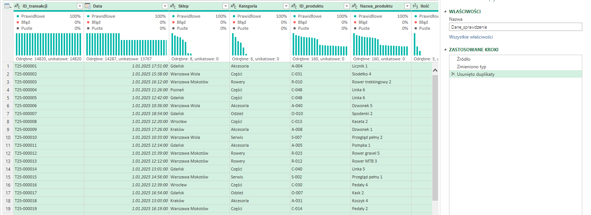

*Screen 10: Removing duplicates*

After removing duplicates, the ID_transakcji column has **14,820** values, both distinct and unique, so each ID now appears only once. So it was the better option: some transactions had been loaded twice.

**Unfortunately this already affects the report:** because the report was built on data containing duplicates, indicators such as the number of transactions, revenue, cost, and results for the shops and categories containing these duplicates may be overstated.

### Data (Date)

Next is the Data (Date) column. It is in date-and-time format. The minimum and maximum values fall within 2025, the year covered by the report, so this is fine.

I still need to check what this column is used for. If we wanted to check, for example, how many items or receipts are sold per day, Excel could have a problem, because it would look for the date with the time 00:00. At this stage it is hard to say whether this is an error, so I go back to the report to see what the date was used for. In the report it was only used to count the number of transactions per shop, without splitting by days or months, so this format does not cause a problem here.

To check: the report also contains sales by month. It is worth making sure how it was calculated and whether the time in the date affects the result.

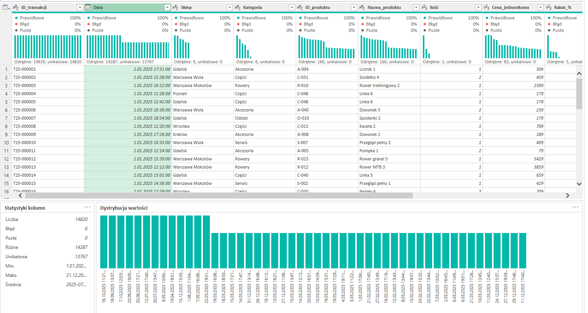

*Screen 11: Profile of the Date column*

### Sklep (Shop)

I move on to the Sklep (Shop) column. The Targets sheet has 6 shops, but here there are 8. The column distribution shows 8 distinct and 0 unique values. Zero unique values is fine, because shop names repeat. In the column profile I noticed that Kraków appears twice, once with a typo ("Krakow" without the Polish "ó"), and Gdańsk also appears twice, probably with a hidden space in one of them.

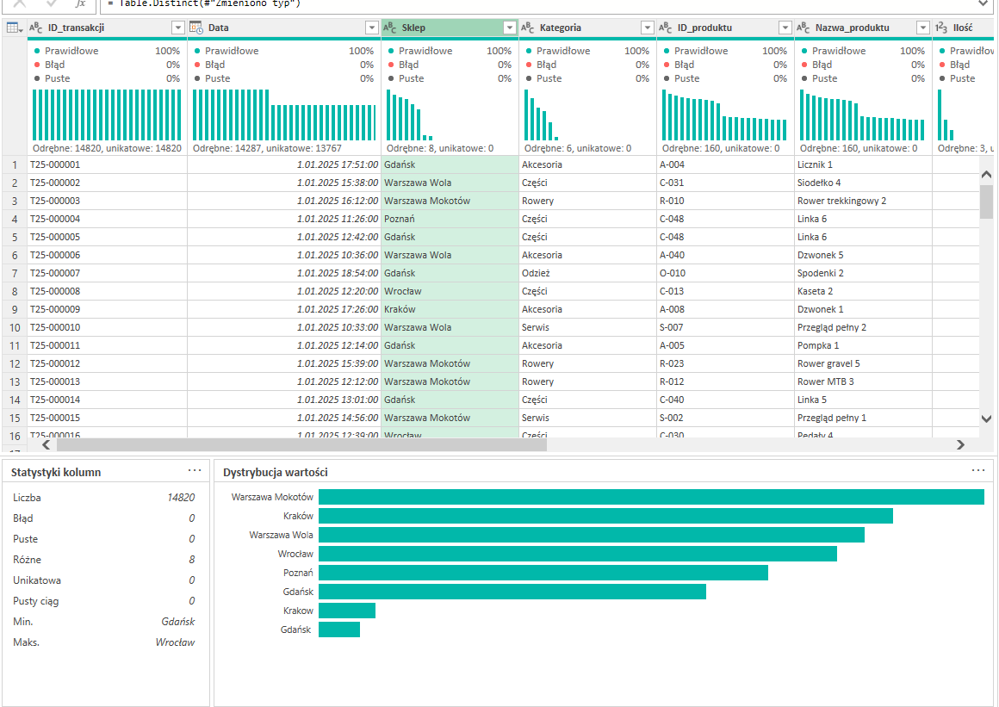

*Screen 12: Values in the Shop column*

I fix the Gdańsk version with a space using **Trim** (Przytnij). After this step 7 shops remain. Then, using **Replace Values** (Zamienianie wartości), I replace "Krakow" with "Kraków". After the replacement **6 shops** remain, the same as in the Targets sheet.

Impact on the report: without this correction, sales for Kraków and Gdańsk would be split into two items, and formulas looking up the shop name, e.g. for target achievement, could miss some transactions.

### Kategoria (Category)

Next is the Kategoria (Category) column.

I cannot see any typos here. Everything seems as it should be, so I move on.

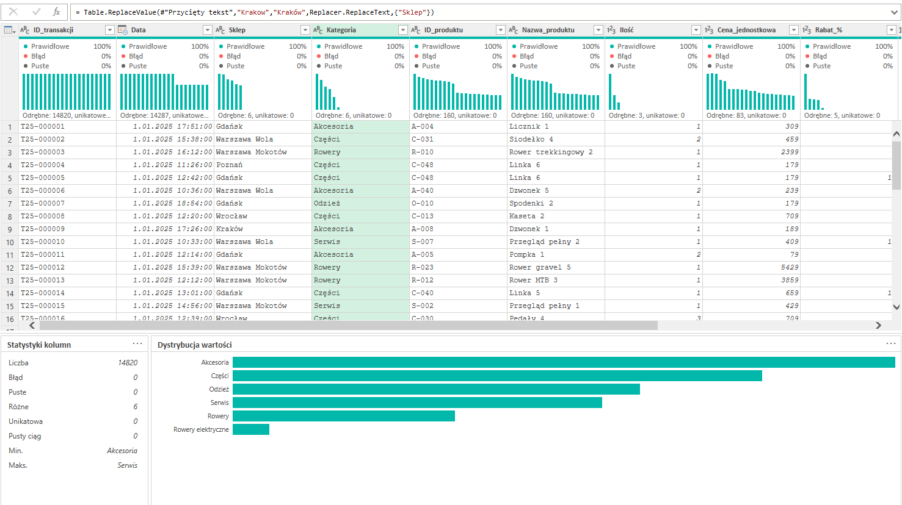

*Screen 13: Profile of the Category column*

### ID_produktu and Nazwa_produktu (Product ID and product name)

Next I move on to the product ID. There are quite a lot of different products. I want to check that the link between the product ID and the product name is correct, i.e. that, for example, A-004 is not sometimes called "Licznik 1" and sometimes "Linka 6".

I do it like this: **Transform → Group By → Advanced**. I group by ID_produktu and Nazwa_produktu and choose the **Count Rows** operation, because I want to see how many rows there are for each ID–name pair.

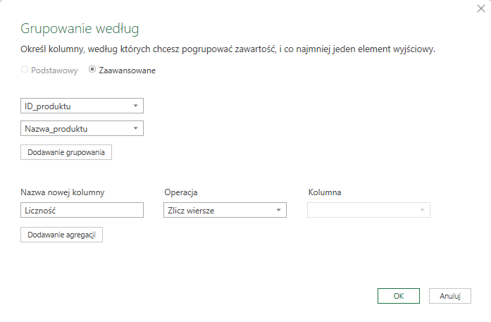

*Screen 14: Grouping by ID and name*

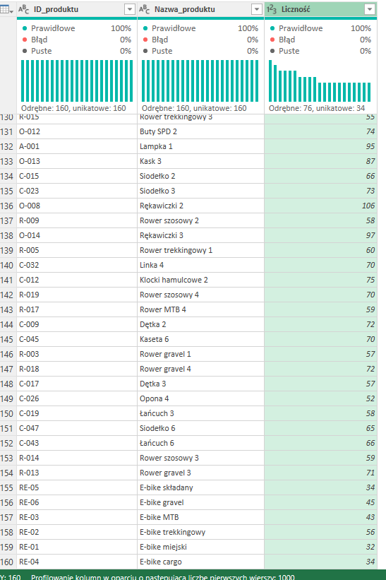

*Screen 15: Result of grouping*

After the check I see **160 rows**, exactly as many as there are different product IDs. This means that each ID has only one name and there is no error here.

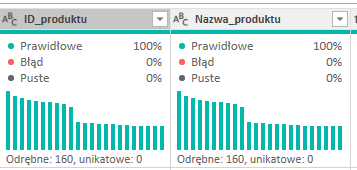

*Screen 16: Number of rows after grouping*

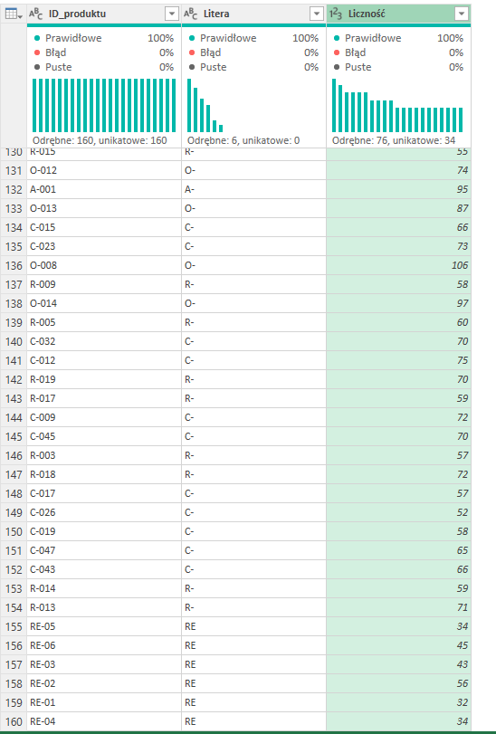

*Screen 17: Result after trimming*

I also trimmed spaces in the ID_produktu column to see whether anything would change, but nothing did. There are still 160 distinct values.

I also decided to check whether each product ID corresponds to one category. The first letter of the ID indicates the category: A is accessories, C parts (części), S service, O clothing (odzież), R bikes (rowery). The new category, e-bikes (rowery elektryczne), has two letters: RE.

I did it like this: I selected the ID_produktu column and chose **Add Column → Extract → First Characters**, with 2 characters. Most categories have one letter, but e-bikes have two, so I chose 2. This way all categories are definitely distinguished.

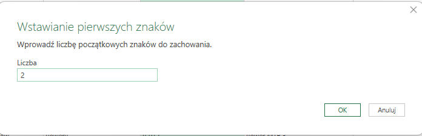

*Screen 18: Extracting the first characters*

Then I grouped by category and the first characters.

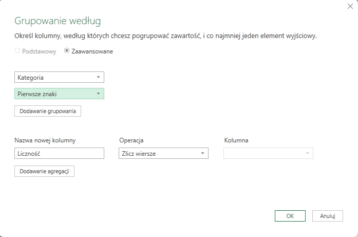

*Screen 19: Grouping by category and first characters*

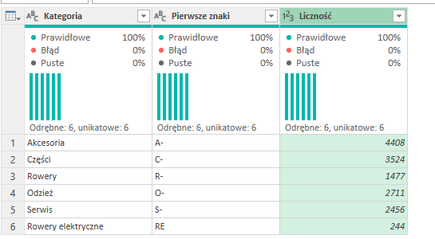

*Screen 20: Result of grouping*

**Here we can see that the category assignment matches the letters in the ID.** The result is 6 rows, so each category has one code. The sum of the Count column is 14,820, so the grouping covered all rows.

This check also confirmed that the product names and categories are consistent.

### Ilość (Quantity)

I leave the Quantity column as it is, because everything is fine. There are only the values 1, 2 and 3, so there is no need to dig deeper.

### Cena_jednostkowa (Unit price)

Next is the unit price. Here it is worth checking whether the unit price matches the product ID. The unit price should always be the same for a given product. The net value may differ, because there is also a discount column, but the unit price should be constant.

Again I use grouping, this time by unit price and product ID.

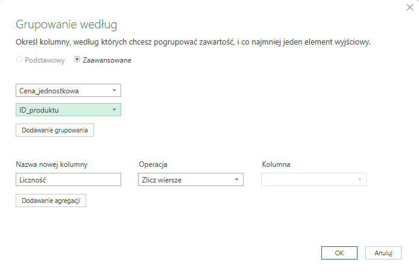

*Screen 21: Grouping by price and ID*

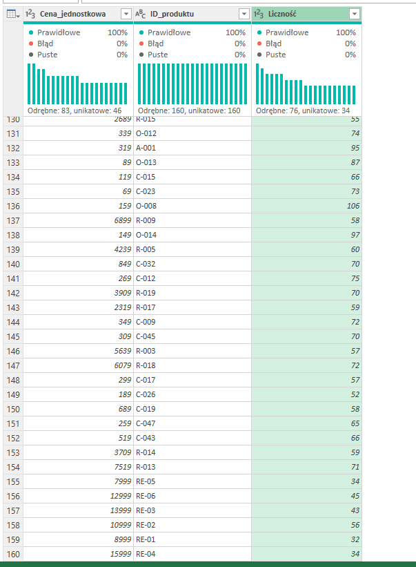

*Screen 22: Result of grouping*

Everything matches: there are 160 product IDs and also 160 rows. So each ID has only one price.

I also check whether the product prices make sense, i.e. whether there is, for example, a negative or zero price. A zero price could possibly mean a free item. In the column statistics I see that the minimum value is **39** and the maximum **15,999**.

### Rabat_% (Discount)

Next is the discount. There are 5 values: 0, 5, 10, 15 and 20%. It is a numeric value. There is probably no error here.

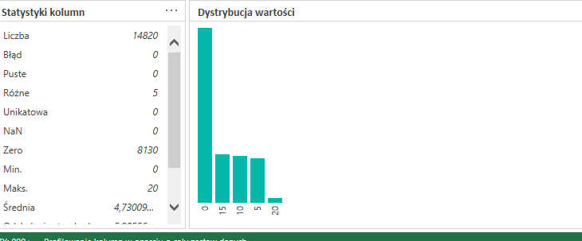

*Screen 23: Discount column*

### Wartość_netto (Net value)

Next I check the net value: does it match the result calculated from the unit price, discount and quantity? I create a custom column for this, with the formula shown in screen 24. In short: net value = quantity × unit price × (1 − discount / 100).

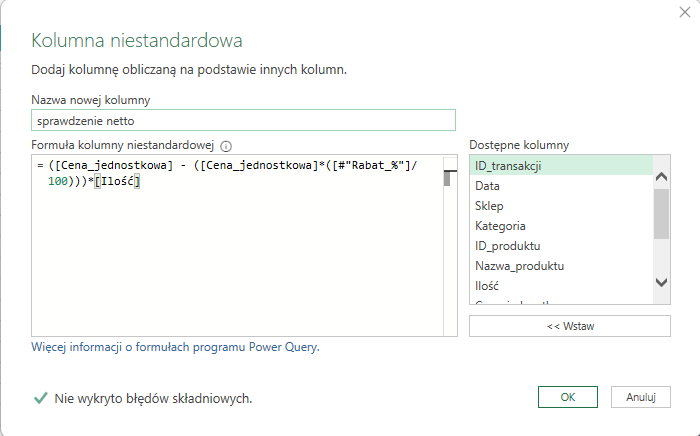

*Screen 24: Custom column – net value check*

After creating the column I change its type to decimal number and then round it to 2 decimal places. This matters, because without rounding the next step could show differences far beyond the decimal point, which we do not want.

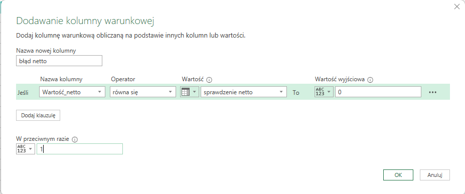

*Screen 25: Rounding*

Then I add a conditional column that checks whether the net value equals the value in the "net value check" column. If it does, the conditional column shows 0, otherwise 1.

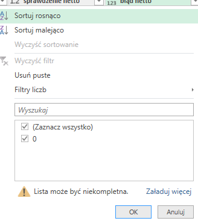

*Screen 26: Conditional column*

After creating the column I click the filter and see that it contains only zeros. So the net value is calculated correctly in every row. Had I not rounded the result to 2 decimal places beforehand, ones would probably have appeared, caused by approximation errors far beyond the decimal point.

### Status

The next column is Status. It contains two statuses: Anulowana (Cancelled) and Zrealizowana (Completed). There is nothing wrong with the data itself here.

### Koszt (Cost)

Here I want to check whether there is anything suspicious. The Cost column holds the cost of the whole order, not of one unit, so first I calculate the cost per unit. I add a custom column with the formula shown in screen 27.

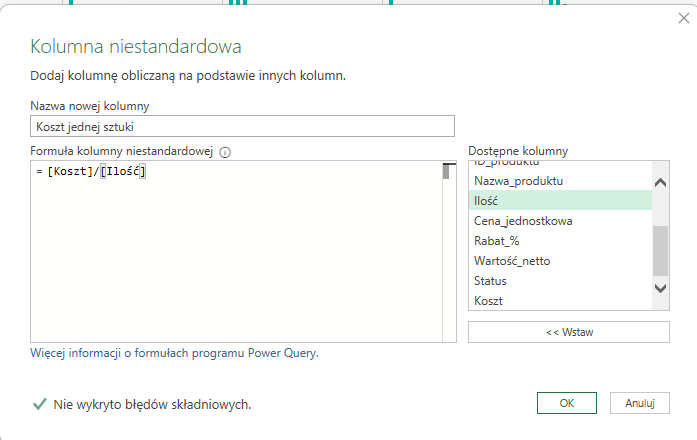

*Screen 27: Cost per unit*

Then I group by product ID and cost per unit, to check whether the cost changed during the year. If it changed often, this could indicate an error. One or two changes in a year should not be suspicious.

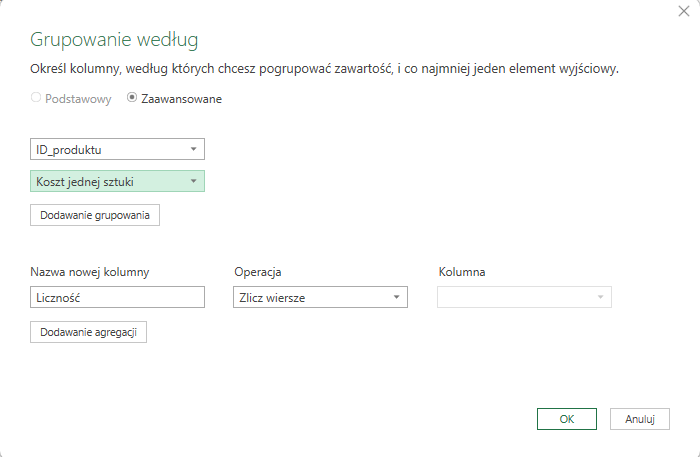

*Screen 28: Grouping by ID and cost per unit*

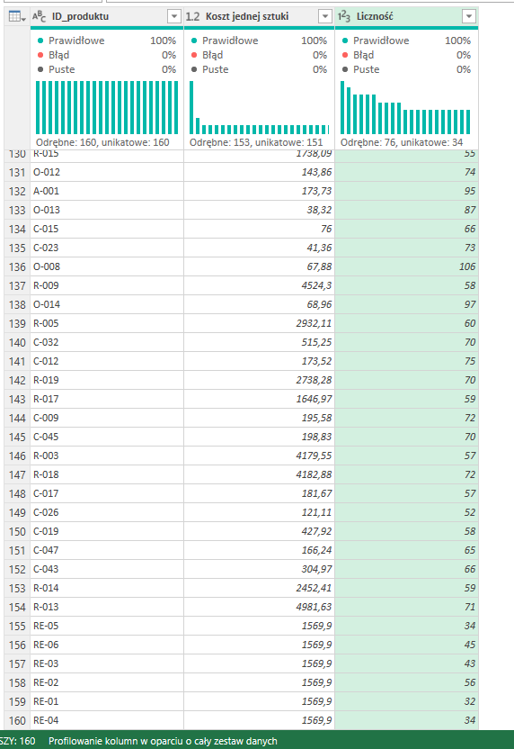

*Screen 29: Result of grouping*

The grouping result is 160 rows, which means that each product had the same cost throughout the year.

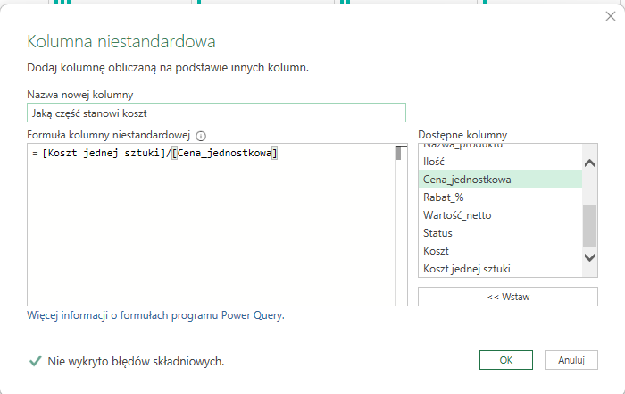

*Screen 30: Share of cost in price*

Next I check what share of the unit price the cost per unit represents. To do this I divide the cost per unit by the unit price.

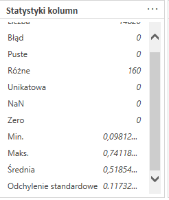

*Screen 31: Column statistics*

In the column statistics I see that the lowest value is below 10%. I check which products these are: e-bikes. The cost of these bikes is always **PLN 1,569.90**, regardless of whether the unit price of the e-bike is about PLN 8,000 or 16,000. This seems quite suspicious to me.

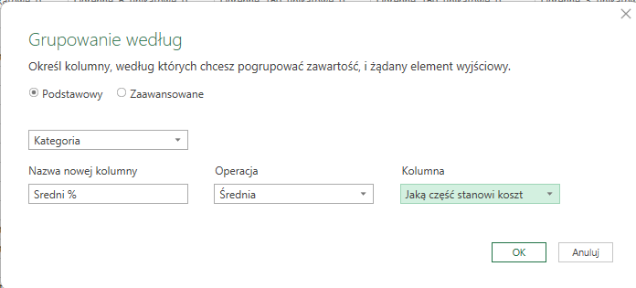

*Screen 32: Grouping by category – average share of cost in price*

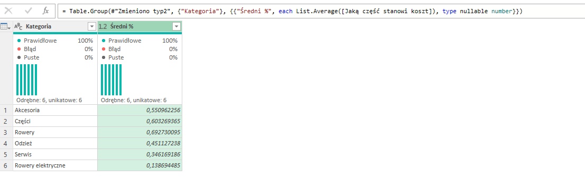

*Screen 33: Average share of cost by category*

I grouped by category and checked what share of the price the cost represents on average. For e-bikes it is suspiciously low: only about **14%** on average, while for regular bikes it is almost **70%**. I would definitely take this result back to the person responsible for collecting the data.

In the other categories I do not see any unusual anomalies. Service also has a fairly low percentage, but this is not surprising, because in a service the customer pays mainly for the mechanic's work, and the cost of materials used (e.g. lubricants, small parts) is low compared with the price of the service.

## 5. Checking the Report sheet

After checking and cleaning the data, I move on to the report itself. I check each table in turn: first the formulas used to calculate it, and then whether the results match the data.

### Sales by month

I start with sales by month. The table title says it was pasted from a PivotTable refreshed on 10 December 2025. I will build my own PivotTable up to the end of the year and see what does not match. I treat revenue as the net value summed for each month.

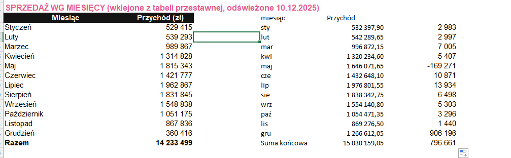

*Screen 34: My PivotTable next to the report table, with differences*

After pasting the PivotTable into the report and calculating the differences, I see that there is no month in which the revenue matches. My revenue figures are mostly higher. I thought that maybe my predecessor had confused revenue with profit, although then the differences would probably be larger. I decided to check this.

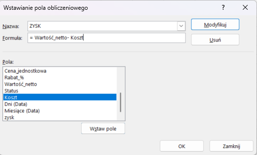

*Screen 35: Calculated field ZYSK (profit)*

To do this I created a calculated field in the PivotTable: net value minus cost, which gives the profit.

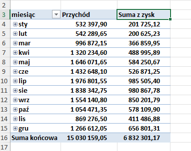

*Screen 36: PivotTable with revenue and profit*

As screen 36 shows, this is not the reason for the difference. Profit is roughly half of revenue, so it does not resemble the figures in the report.

I thought about it once more and noticed a mistake of my own. For revenue I had taken all transactions, including cancelled ones, but cancelled transactions do not actually bring in revenue. So I added a **Status** filter to the PivotTable and set it to count only **completed** transactions.

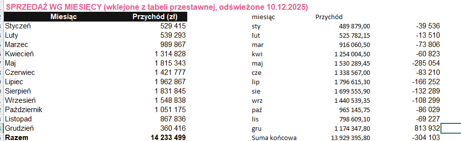

*Screen 37: Comparison after adding the Completed filter*

Now it looks like screen 37. The differences are even larger. I think they may be caused by the duplicates that were in the data and which I removed (178 duplicated transactions). Interestingly, my table was closer to Marek's results when it did **not** have the status filter. So I will build the same table on the raw data to check whether this is the reason.

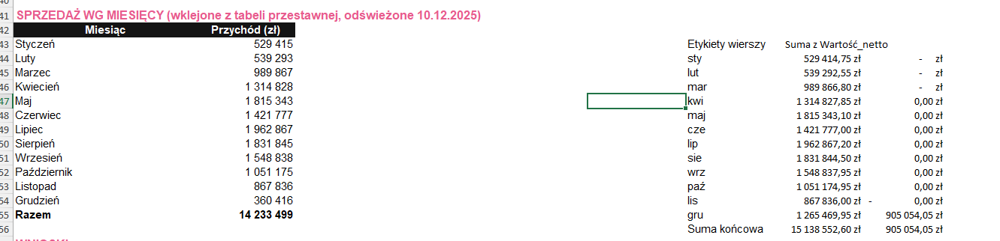

*Screen 38: PivotTable on Marek's raw data, all statuses*

The PivotTable built on the original data clearly shows no difference except for December. This is because sales by month were calculated only up to 10 December, so December is incomplete. The table in the report is therefore wrong for two reasons:

1. the data it was built on contains duplicates,
2. a logic error: all transactions were included, but cancelled transactions are not revenue.

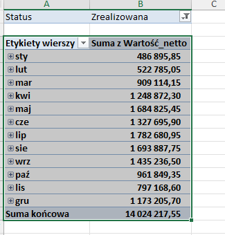

*Screen 39: PivotTable on Marek's data, completed transactions only*

Even if we used Marek's original data and included only completed transactions, the differences are significant, as screen 39 shows. So I paste into the report the revenue I calculated on the cleaned data, of course only for completed transactions.

In addition, the table contains **pasted values** rather than formulas or a linked PivotTable, so it does not update with the data. That is why December is incomplete. The total of this table (PLN 14,233,499) also differs from the net revenue in the key indicators (PLN 15,138,553), so the report was not even consistent with itself.

### Sales and margin by category

I move on to the sales and margin by category table. There are 6 categories, as in reality. The table shows revenue, cost and margin %. First I check the formulas used and whether they make sense. Revenue comes first.

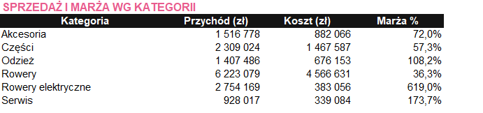

*Screen 40: Original category table created by Marek*

Above is the original table created by Marek. The revenue formula, in this case for accessories, is:

`=SUMIFS(Dane!$J$2:$J$14999,Dane!$D$2:$D$14999,A33)`

I go to the Data sheet to check whether what Marek did makes sense. The summed column is J, which in the data is indeed the net value. The first criteria range is column D, i.e. the category, also correct. The criterion is A33 from the Report sheet, i.e. the category name "Akcesoria". This is also correct: the formula looks for this name in column D, as long as the name is written exactly the same way as in the data.

What is missing is a condition that the order was **completed**. At the moment all orders are counted, and we know there are both completed and cancelled ones. So the revenue column is wrong, because one more condition needs to be added.

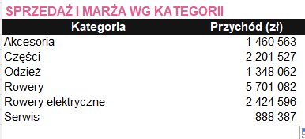

*Screen 41: Revenue after adding the Completed condition*

This is the difference after adding the condition that orders must be completed. However, we know that the source data contained duplicates, among other things, so at the end I will rebuild the whole table on my data. Meanwhile I move on to cost.

`=SUMIFS(Dane!$L$2:$L$14999,Dane!$D$2:$D$14999,A33)`

This is the cost formula. The error is most likely the same: we do not know whether we are talking about completed orders, because the formula sums all orders.

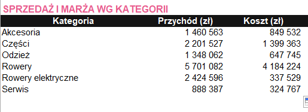

*Screen 42: Cost after adding the Completed condition*

After adding the extra condition the cost decreased, because there are fewer orders. Now I move on to the last column, the margin. At first glance you can see that in some cases the margin is above 100%, even around 600%, which is very unlikely.

Marek calculated the margin as (revenue − cost) / cost. This is how **markup** is calculated, not margin. Markup answers the question of how much we raised the price compared with what we paid ourselves. Margin tells us what part of the customer's money stays in our pocket. Marek confused these two concepts. The correct way is to subtract cost from revenue and divide the result **by revenue**. A margin cannot exceed 100%, because profit cannot be larger than the whole revenue. Values of 108%, 174% or 619% immediately pointed to an error in the formula.

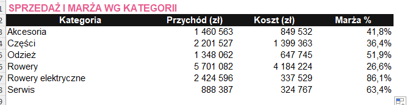

*Screen 43: Corrected category table on Marek's data*

This is the corrected table on Marek's data. While checking the data I noticed that the cost of e-bikes is the same for every model, regardless of price, at PLN 1,569.90. In my opinion this is a data entry error. So I note that the cost and margin for e-bikes **are not something we should rely on**, and they definitely need to be checked.

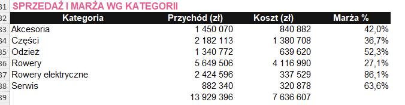

*Screen 44: Category table on the cleaned data*

I also rebuilt this table on the cleaned data. It looks like screen 44, and again there is a difference. Finally, I summed the revenue and cost columns as a control check against the cleaned data. I do it by filtering the status to completed transactions and selecting the Wartość_netto (Net value) column. The status bar at the bottom should show the same sum as the revenue in the report. Likewise, selecting the Koszt (Cost) column should show the sum of the cost of completed orders.

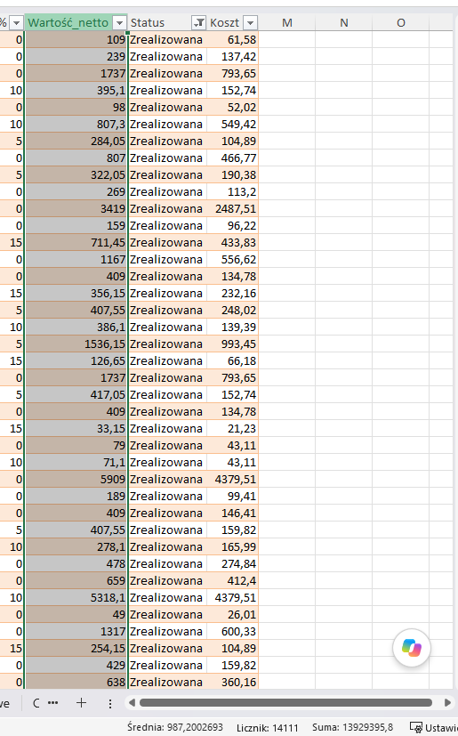

*Screen 45: Control sum of revenue in the status bar*

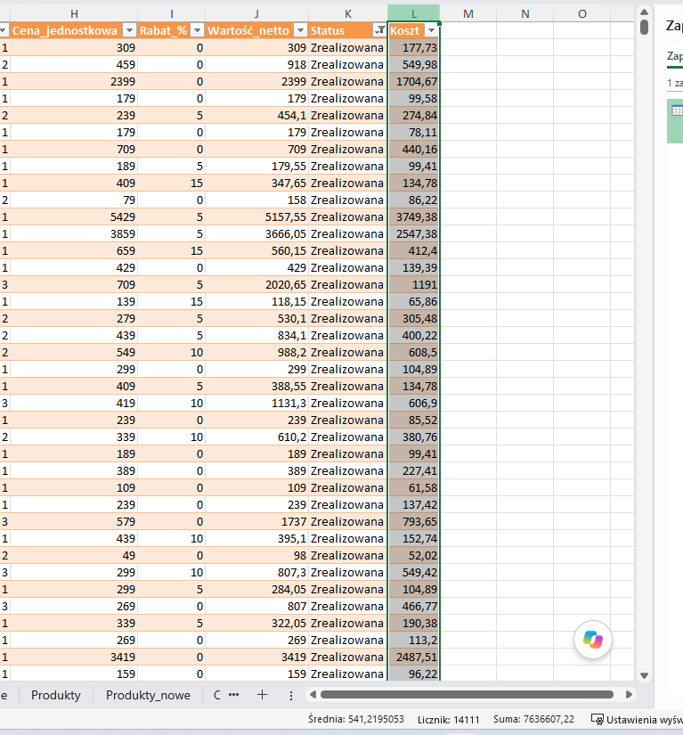

*Screen 46: Control sum of cost in the status bar*

As screens 45 and 46 show, after rounding the sums match the results in my report.

### Sales by shop

Now I move on to the sales by shop table. From the data I cleaned I know for sure that there were errors in shop names: Kraków with and without "ó", and Gdańsk in two versions. So I suspect the figures in this table are off, because they do not include the shops with incorrect names. I will look at the formulas in this table. The table is shown below.

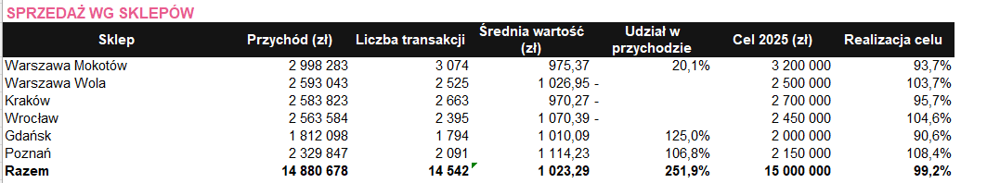

*Screen 47: Original shop table*

The revenue formula is:

`=SUMIFS(Dane!J2:J14999,Dane!$C$2:$C$14999,A23)`

The summed column is J, the net value, which is perfectly fine. The criteria range is column C, the shop, also fine. The criterion is A23, which refers to the shop name in the Report sheet. This is also fine, provided the data is properly cleaned, and I know it is not. That is already an error. I show it in the screenshot below, in the filter of the Sklep (Shop) column header, where more shops are visible than there should be.

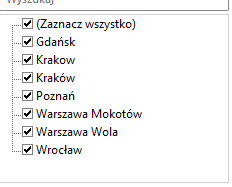

*Screen 48: List of values in the Shop column filter*

The second Gdańsk is not on the list, because the Gdańsk error was an extra space. The Excel filter does not show it and merges both versions into one item, but formulas do distinguish them.

Another recurring error is that revenue covers all transactions, completed and cancelled, while it should cover only completed ones. So another condition needs to be added, which I will do in a moment.

A small disclaimer: this could also be done on the original data, for example by adding two conditions for Kraków, i.e. "Kraków" with "ó" and "Krakow" without it. However, we know there are more errors in this data, and good practice is simply to clean the data first.

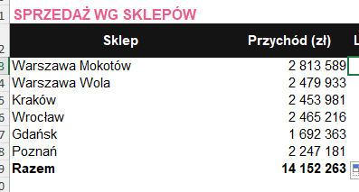

*Screen 49: Shop revenue after adding the condition, source data*

This is the table after the change on the source data. Now I move on to the number of transactions. The earlier screenshots showed that, after removing duplicates, there are about 14 thousand completed transactions, while here the total is 14,542. But first I check the formula:

`=COUNTIFS(Dane!$C$2:$C$14999,A23)`

The formula counts rows for a given shop, for both completed and cancelled orders. So I add a condition on status.

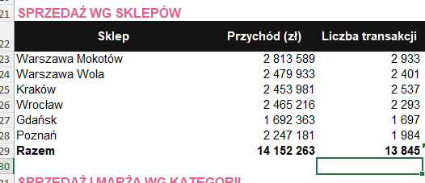

*Screen 50: Number of transactions after adding the Completed condition*

As you can see, the number of transactions also changed. Interestingly, it is lower than mine after removing duplicates. This is probably because the formula does not pick up the rows with "Krakow" and "Gdańsk " with a space.

Next is the average transaction value. Marek calculated it by dividing revenue by the number of transactions, which is correct. In the Total row he also divided the total revenue by the total number of transactions, which is also correct. This column stays unchanged.

The next column is share of revenue. Marek calculated it using the IFERROR function (JEŻELI.BŁĄD).

*Screen 51: Share of revenue column in the original table*

The first thing that stands out: the shares of revenue add up to 239.6%, while they should add up to 100%. Something is already wrong at this level.

`=IFERROR(B23/B29,"-")`

Marek used IFERROR to hide possible errors. For example, when dividing by zero, a dash appears instead of an error, which looks nicer. The formula itself is fine, because it divides the shop's revenue by the value in the Total row and shows the result as a percentage.

I checked why some shops have no value while Gdańsk and Poznań have such large ones. The formula has **no $ sign locking** the total, neither before the letter nor before the number. When the formula is copied down, the denominator also moves down. That is why the formula calculates incorrectly: it suddenly divides by empty cells or completely different numbers. The screenshot below shows this very clearly. This is another error in the report. In addition, IFERROR **hid** this error: instead of a #DIV/0! message, innocent-looking dashes appeared in the table.

*Screen 52: Formula in the Gdańsk row divides by B33 instead of B29*

I changed the formula as follows:

`=IFERROR(B23/$B$29,"-")`

*Screen 53: Corrected share of revenue*

The table now looks like screen 53. The shares of revenue add up to 100%, and the figures are no longer detached from reality.

Now I move on to the Cel 2025 (2025 target) column. It should contain data looked up from the Targets sheet. Below is a screenshot of that sheet.

*Screen 54: Targets sheet*

`=VLOOKUP(A23,Cele!$A$2:$B$7,2,FALSE())`

Everything was looked up correctly here, but XLOOKUP would be much safer. It is harder to make a mistake with it and it is more flexible, for several reasons:

- you do not have to remember the FALSE argument, which you also need to understand well,
- you decide what is shown when the formula finds nothing,
- if someone inserted a new column in the Targets sheet, VLOOKUP would still take data from the second column, because the number 2 is hard-coded, while XLOOKUP points directly to the target column, so nothing breaks.

Overall, however, this formula is also correct. I also checked the results directly against the Targets sheet and everything matches.

The last column is target achievement. It is calculated correctly: revenue divided by target. No $ locking is used here, and none is needed, unlike for share of revenue: when copying the formula down, we want both values to move. The Total row is also calculated correctly, as total revenue divided by total target.

*Screen 55: Corrected shop table on Marek's data*

Screen 55 shows the corrected table and screen 47 the original. There are some differences. However, this table is still not reliable, because it does not include Gdańsk with a space or Krakow without "ó", and it contains duplicates. So I will rebuild it on the cleaned data.

*Screen 56: Shop table on the cleaned data*

After rebuilding it on the cleaned data, the table looks like screen 56. The number of transactions caught my attention: earlier I said there were 14,111 completed transactions, and here there are 14,110. I remembered that I had probably selected the column together with its header. I checked again, selecting from the second row and pressing Ctrl+Shift+↓. There are indeed **14,110** completed transactions, so everything matches. Below is a screenshot of the status bar as proof of the check.

*Screen 57: Status bar: count and sum for completed transactions*

### Key indicators

The last table to check is the key indicators. There are 9 of them and I check them one by one.

*Screen 58: Original key indicators*

**Net revenue 2025.** The formula used is `=SUM(Dane!J2:J14999)`, the sum of column J of the Data sheet with the net value. This is another error, because again there is no condition to include only completed orders. The control sum in the status bar for the whole column matches, but as I mentioned, the result is still wrong. To calculate this indicator I use SUMIFS:

`=SUMIFS(Dane!J2:J14999,Dane!$K$2:$K$14999,"Zrealizowana")`

Current result: **PLN 14,024,218**.

**Number of transactions.** Here the number is calculated with `=COUNTA(Dane!A2:A14999)` on the transaction ID. It has the same status problem, so it is also a wrong indicator. In addition, COUNTA also counts the 178 duplicated rows.

I think it is worth splitting this indicator into three: the total number of transactions, the number of completed transactions and the number of cancelled transactions. Showing the share of cancelled orders can give us additional information, especially if there were many cancellations. If the data allowed it, we could start investigating why orders were cancelled and what caused it.

I solve it like this: I rename the existing indicator "Total number of transactions", because that is what it is. I add two indicators, the number of completed and cancelled transactions, as counts and, next to them, as a percentage of all transactions. I calculate them with COUNTIFS:

`=COUNTIFS(Dane!$K$2:$K$14999,"Zrealizowana")`

`=COUNTIFS(Dane!$K$2:$K$14999,"Anulowana")`

- Total number of transactions: **14,998**
- Number of completed transactions: **14,278**
- Number of cancelled transactions: **720**

Then I adjusted the formulas to the cleaned data. Now the figures are:

- Total number of transactions: **14,820**
- Number of completed transactions: **14,110**
- Number of cancelled transactions: **710**

**Average transaction value.** As the screenshot below shows, it is calculated incorrectly. This is another error: Marek calculated the average of the shops' average transaction values, i.e. the average transaction value **per shop**, not per single purchase.

*Screen 59: Average transaction value calculated as AVERAGE(D25:D30)*

I change it by dividing the 2025 net revenue by the number of completed transactions.

**Annual target for the chain.** The value is typed in manually. I consider this an error: it is better for it to refer directly to the Targets sheet, so I use the sum of the targets from that sheet. It turned out that the typed value was also wrong: **13,500,000** was entered, while the sum of the targets is **15,000,000**.

**Target achievement.** Revenue is divided by the target, which is perfectly fine, so I leave it.

**Cost of goods sold.** It is calculated with the SUM formula, simply on column L of the Data sheet, i.e. cost. There is no condition for completed orders, so this is another error: the cost in the report is overstated. I use SUMIFS:

`=SUMIFS(Dane!L2:L14999,Dane!$K$2:$K$14999,"Zrealizowana")`

Current result: **PLN 7,743,160**.

**Margin %.** It is calculated by subtracting the cost of goods sold from net revenue and dividing the result by cost. Again this is not calculated correctly, because it is markup, not margin. I change it so that revenue minus cost is divided by revenue.

**Q4 revenue.** It is calculated with SUMIFS, using the formula below:

`=SUMIFS(Dane!J2:J14999,Dane!B2:B14999,">"&DATE(2025,10,1),Dane!B2:B14999,"<"&DATE(2025,12,31))`

The problem with this formula is, again, that Marek does not take into account that some orders were cancelled. The second issue is the date boundaries. Order dates are stored with times. For example, a transaction on 31 December at 15:20 is greater than 31 December at midnight, so it does not meet the "less than" condition and drops out of the sum. The October boundary happens to work, but only by chance, thanks to the times. If the data contained dates without times, 1 October would drop out.

I change the formula to the one shown below:

`=SUMIFS(Dane!$J$2:$J$14999,Dane!$B$2:$B$14999,">="&DATE(2025,10,1),Dane!$B$2:$B$14999,"<"&DATE(2026,1,1),Dane!$K$2:$K$14999,"Zrealizowana")`

I set the date to be greater than or equal to 1 October, so the formula captures the whole first day. I set the second date to be less than 1 January 2026, so it captures the whole of 31 December. I also added the condition that orders must be completed. A rule that works for any period: "from" is >= the first day of the period, and "to" is < the first day of the next period.

Current result: **PLN 2,932,224**.

**Q4 share of annual revenue.** It was calculated by dividing fourth-quarter revenue by net revenue, which is correct.

As I mentioned earlier, the data Marek worked on is wrong, because it contains, among other things, duplicates and inconsistent shop names. That is why I also rebuild all the key indicators on the cleaned data.

*Screen 60: Key indicators and shop table on the cleaned data*

After recalculating the indicators on the sheet with cleaned data, I noticed something that had already raised a red flag earlier. The average transaction value should be the same as the average value in the Total row of the sales by shop table, and revenue should also be the same in both tables. As screen 60 shows, there is a difference. I quickly found the cause in the revenue column of the shop table. The problem was a **missing $ sign** on the sum range: when the formula was copied, everything shifted, as shown in the screenshot below. This error comes from Marek's original formula, in which the sum range Dane!J2:J14999 was not locked either.

*Screen 61: Shop revenue formula without a locked sum range*

After this change the table looks as follows:

*Screen 62: Shop table after the correction*

The data now matches the key indicators: revenue is **PLN 13,929,396** and the average transaction value is **PLN 987.20**.

## 6. Reviewing the conclusions

At the end of the report Marek wrote 5 conclusions for the board. I checked each of them against the corrected results.

### Conclusion 1

> *"2025 was a record year: PLN 15.1 million in revenue and 112% achievement of the chain's target."*

This cannot be concluded from the data we have. We only have data for 2025, so we do not know whether it was a record year. The figures of PLN 15.1 million and 112% come from Marek's incorrect indicators: revenue including cancelled transactions and duplicates, and a manually entered target of PLN 13.5 million. After the corrections, revenue is **PLN 13.93 million** and target achievement is **92.9%**, which means **the chain did not meet its target**. The conclusion is therefore reversed.

### Conclusion 2

> *"A margin of 82% – the highest in the company's history. E-bikes were a bull's-eye (margin over 600%); I propose doubling their stock in 2026."*

This cannot be concluded from the data either, because we have no historical data to compare with. The 82% margin and the "over 600%" are in fact **markup**, not margin. After the corrections, the chain's margin is **45.2%**. The e-bike margin (86%) is calculated on a suspicious cost of PLN 1,569.90, so it cannot be the basis for a decision to double the stock until the cost has been clarified.

### Conclusion 3

> *"Best shop: Poznań (108% of target). Gdańsk performs worst (91% of target) – to be discussed with the shop manager."*

After the corrections, the best shop in terms of share of revenue is **Warszawa Mokotów (20.2%)**, and the weakest are **Gdańsk and Poznań (14.5% each)**.

However, I would not suggest a conversation with the shop manager here. I do not know whether this level of revenue is simply typical for that shop. What is more, these shops achieved their targets better than Warszawa Mokotów, which has the highest revenue. Instead, I would investigate why **both Warsaw shops achieved less than 90% of their targets**, while the others achieved more.

### Conclusion 4

> *"December was very weak (PLN 360 thousand, the worst month of the year). I propose cutting the December 2026 marketing budget."*

December was not the weakest month. The figure of PLN 360 thousand came from the table covering data only up to 10 December. After the corrections, December revenue is **PLN 1,174,348**. I also calculated each month's share of annual revenue: the weakest are **January and February (4% each)**, while December has **8%**.

*Screen 63: Sales by month after the corrections, with percentage share*

I do not think cutting the December marketing budget is necessarily the right decision. I would rather look for marketing opportunities to increase December sales around Christmas, but that is a decision for the board.

### Conclusion 5

> *"Q4 is 21% of annual sales, so the winter season does not require any additional action."*

This conclusion somewhat contradicts the previous one: according to conclusion 4, December, which is part of Q4, requires action, while according to conclusion 5 the whole of Q4 does not. After the corrections, Q4 is indeed about **21%** of annual revenue, and Q3 is **35%**. However, it is hard for me to say whether this is good or bad, because I do not know the data from previous years to compare with.

## 7. The report after the changes

I first checked the formulas in the report on the data prepared by the previous employee. This allowed me to assess the reasoning itself, i.e. whether the formulas are built correctly, regardless of data quality. After correcting the formulas, I switched their source sheet to the cleaned data.

This second step is just as important as the first. Had I skipped it, the report would still show wrong results despite the corrected formulas, e.g. for revenue or margin, because it would be based on data with duplicates and inconsistent shop names. Such figures could in turn lead to wrong business decisions.

Below is the whole report after all the changes.

*Screen 64: Report after the changes – key indicators and sales by shop*

*Screen 65: Report after the changes – sales and margin by category, and sales by month*

## 8. Dashboard

The report was needed urgently, so I used Copilot in Excel to visualise it. In my opinion the original layout of the report was not very readable, so I asked Copilot to generate a dashboard that presents the most important results clearly.

*Screen 66: Dashboard – summary and key indicators*

*Screen 67: Dashboard – revenue by quarter*

*Screen 68: Dashboard – revenue by month*

*Screen 69: Dashboard – shop and category results by revenue*

*Screen 70: Dashboard – shop target achievement and category margin*

*Screen 71: Dashboard – shop details*

Copilot built the dashboard from the indicators in the corrected report. I had verified the transaction data myself beforehand. I also checked the finished dashboard: I compared its values with the corrected indicators and made sure that the charts are linked to the data rather than hard-coded.

## 9. Conclusions and recommendations for the board

### 1. Target achievement

The chain did not meet its annual target. Revenue was PLN 13.93 million, which is 92.9% of the target. About PLN 1.07 million was missing to reach it.

### 2. Cancelled transactions

In 2025, 710 transactions were cancelled, about 5% of all transactions. It is worth starting to collect the reasons for cancellations, to see whether some of them could be avoided.

### 3. Data quality

In the data I found duplicated transactions, inconsistent shop names and a suspicious cost for e-bikes. I recommend clarifying the cost of this category and introducing a data quality check before preparing future reports.

### 4. Sales seasonality

The company earns the most in Q3 (35.4% of annual revenue), and the best month is July. This is most likely due to the peak of the cycling season. The weakest is Q1 (13.9%), especially January and February.

There is also a visible increase in sales in December, probably related to Christmas. Although it is not the cycling season, December revenue is close to April's.

I suggest considering two actions:

- **Gift vouchers for a bike or a service**, if the company does not offer them yet. The Christmas increase in sales shows that some customers are looking for gifts in December, so it is worth taking advantage of this. The revenue comes in December, and the customer comes in during the season.
- **A pre-season promotion in February and March.** Q1 is the weakest, and sales pick up in March. A "buy early" promotion or a pre-season service could move some purchases to earlier months and ease the peak of the season.

### 5. Shop results

The Warszawa Mokotów shop generates the highest revenue, but Gdańsk achieved its target best (101.3%). Warszawa Mokotów is second to last in this respect (87.8%). It is worth investigating why both Warsaw shops achieved their targets less well than the others.

### 6. Categories and margin

Bikes bring the highest revenue, but their margin is only 27.1%.

E-bikes show the highest margin. In my opinion, however, this is due to an error in the data: the unit cost of every model is PLN 1,569.90, regardless of the bike's price (from about PLN 8,000 to 16,000). Until this is clarified, no decisions should be based on this result.

Service has a high margin (63.6%). I suggest considering:

- **marketing activities** encouraging customers to have their bike prepared before the season and serviced after it. Such services are usually done just before or after the season, so they could increase profit in the quarters with lower revenue,
- **bundles with a bike purchase**, e.g. a helmet, lights and a lock, or a first service at a lower price. The customer needs these things anyway, and the shop earns more on them than on the bike itself.

## 10. Note to my manager

Good morning,

I have checked the 2025 sales report and unfortunately I do not recommend sending it to the board in its current form. I found errors in the data, formulas and conclusions. Some of them clearly change the picture of the year: according to the report, the chain exceeded its target, while in reality it did not meet it.

The differences come mainly from:

- errors in the source data (duplicated transactions, inconsistent shop names),
- formulas that also included cancelled transactions,
- margin calculated as markup,
- a monthly table containing data only up to 10 December 2025.

As a result, the conclusions in the report are no longer valid and could lead to wrong business decisions.

I have prepared a corrected version of the report, which I attach. I suggest sending this version to the board. I am also attaching a list of all the errors I found, in case it is needed.

Best regards,  
Magda

## 11. Summary – list of errors

In total I found **22 errors**: 17 in the data and formulas, and 5 incorrect conclusions.

**Data (3)**

- **Error 1: Duplicated transactions (178)** – overstated revenue, cost and number of transactions across the whole report.
- **Error 2: Inconsistent shop names ("Krakow", "Gdańsk " with a space)** – part of Kraków's and Gdańsk's sales was not counted.
- **Error 3: The same cost for every e-bike (PLN 1,569.90)** – overstated margin for this category; to be verified.

**Sales by month (1)**

- **Error 4: Revenue: data only up to 10 December and including cancelled transactions** – understated December and overstated other months.

**Sales and margin by category (3)**

- **Error 5: Revenue without a status condition** – overstated category revenue.
- **Error 6: Cost without a status condition** – overstated category cost.
- **Error 7: Margin calculated as markup** – margins above 100% (up to 619%).

**Sales by shop (3)**

- **Error 8: Revenue without a status condition and without $ locking** – overstated revenue, summed from the wrong rows.
- **Error 9: Number of transactions without a status condition** – overstated number of transactions.
- **Error 10: Share of revenue without $ locking** – shares adding up to 239.6% and dashes instead of results.

**Key indicators (7)**

- **Error 11: Net revenue without a status condition** – PLN 15.14 million instead of PLN 13.93 million.
- **Error 12: Number of transactions including cancelled ones** – 14,998 instead of 14,110 completed.
- **Error 13: Average transaction value as an average of the shops' averages** – distorted average.
- **Error 14: Annual target typed in manually (PLN 13.5 million instead of PLN 15 million)** – target achievement of 112% instead of 92.9%.
- **Error 15: Cost of goods sold without a status condition** – overstated cost.
- **Error 16: Margin calculated as markup** – 82% instead of 45.2%.
- **Error 17: Q4 revenue: wrong date boundaries and no status condition** – 31 December left out and cancelled transactions included.

**Conclusions (5)**

- **Error 18: "Record year, 112% of target"** – in reality the target was not met (92.9%).
- **Error 19: "Margin 82%, double the e-bike stock"** – a recommendation based on markup and an incorrect cost, with the risk of a bad purchasing decision.
- **Error 20: "Best Poznań, worst Gdańsk"** – in reality Gdańsk achieved its target best.
- **Error 21: "December the weakest, cut the marketing budget"** – December was PLN 1.17 million; the weakest months are January and February.
- **Error 22: "Q4 does not require action"** – contradicts conclusion 4, with no data for comparison.
